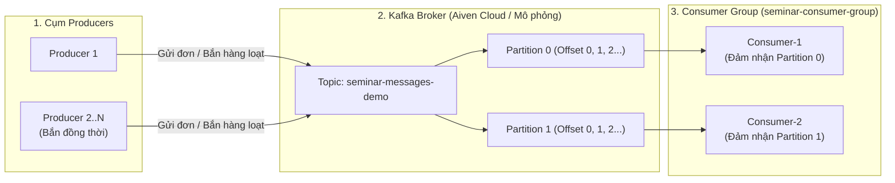

# 🚀 Demo Apache Kafka & Aiven Cloud — Gửi Tin Nhắn & Giả Lập Xử Lý Đồng Thời

Dự án minh họa trực quan kiến trúc **Message-Driven SOA với Apache Kafka**, phục vụ báo cáo **Seminar SOA**.  
Ứng dụng cung cấp **Web Dashboard thời gian thực (`http://localhost:3000`)** giúp quan sát toàn bộ vòng đời của bản tin từ khi được **Producer** phát đi, phân bổ tải vào các **Partitions** trên **Broker**, cho đến khi được các **Consumers (Consumer Group)** nhận và xử lý song song.

---

## 📖 1. Giới thiệu về Apache Kafka & Bài toán Demo

### 1.1. Apache Kafka là gì?
**Apache Kafka** là nền tảng truyền tải sự kiện phân tán (Distributed Event Streaming Platform) có khả năng chịu tải cao, độ trễ thấp và lưu trữ bền vững. Trong kiến trúc hướng dịch vụ (**SOA / Microservices**), Kafka đóng vai trò là **Message Broker trung tâm** giúp tách rời (decouple) bên gửi dữ liệu và bên xử lý dữ liệu:

- **Producer:** Các dịch vụ phát sinh dữ liệu/tin nhắn (đơn hàng, thanh toán, log, phân đoạn video/file...).
- **Topic & Partitions:** Kênh chứa dữ liệu được chia thành nhiều ngăn (**Partitions: P0, P1...**) để lưu trữ tuần tự theo chỉ mục (`Offset`) và cho phép mở rộng khả năng xử lý song song.
- **Consumer Group:** Nhóm các Worker cùng chia nhau các Partitions để xử lý dữ liệu đồng thời (mỗi Partition trong cùng 1 thời điểm được giao cho 1 Consumer trong nhóm đảm nhận).



### 1.2. Các tính năng chính trong bản Demo
1. **Gửi 1 tin nhắn đơn lẻ (Single Message):** Cho phép tùy chọn nội dung, định danh Producer và `Message Key` để kiểm tra cơ chế định tuyến Partition.
2. **Giả lập gửi CÙNG LÚC nhiều tin nhắn (Concurrent Multi-Producer Burst):**
   - Mô phỏng từ **3 đến 10 Producers** cùng lúc bắn đồng thời từ **5 đến 200 tin nhắn** tại một thời điểm (sử dụng cơ chế bất đồng bộ song song `Promise.all` hoặc gom lô `Batch`).
   - Đo lường trực tiếp **Tổng thời gian phản hồi (`ms`)**, **Tốc độ thông lượng (`msg/giây`)** và **Độ trễ End-to-End (`ms`)**.
3. **Quan sát trực quan theo thời gian thực (Real-time SSE):**
   - Biểu đồ phần trăm phân bổ tin nhắn vào từng **Partition (`Partition 0`, `Partition 1`...)**.
   - Bộ đếm số lượng tin nhắn mỗi **Consumer Worker** đã xử lý và nhật ký luồng dữ liệu trực tiếp trên giao diện nền sáng.

---

## 💻 2. Hướng dẫn Tải về (Clone) và Khởi chạy Dự án

Bạn có thể chạy dự án bằng **1 trong 2 cách** dưới đây:

### Cách 1: Chạy thuần bằng Node.js

**Yêu cầu:** Máy tính đã cài đặt [Node.js](https://nodejs.org/) (phiên bản 18 trở lên).

```bash
# Bước 1: Clone kho lưu trữ về máy
git clone https://github.com/524h0082-NguyenMinhDang/seminar.git
cd seminar

# Bước 2: Cài đặt các thư viện phụ thuộc (express, kafkajs, dotenv, cors)
npm install

# Bước 3: Khởi động Server Web Dashboard
npm start
```

Sau khi chạy lệnh trên, mở trình duyệt truy cập: **`http://localhost:3000`**

---

### Cách 2: Chạy bằng Docker (Không cần cài đặt Node.js)

```bash
# Bước 1: Clone dự án về máy
git clone https://github.com/524h0082-NguyenMinhDang/seminar.git
cd seminar

# Bước 2: Build và khởi chạy bằng Docker Compose
docker compose up -d --build
```

Sau khi Container chạy, mở trình duyệt truy cập: **`http://localhost:3000`**

---

## ⚙️ 3. Hướng dẫn Sử dụng: Dùng ngay Chế độ Giả lập hoặc Kết nối Aiven Cloud

Khi mở **`http://localhost:3000`**, bạn có thể lựa chọn **1 trong 2 chế độ vận hành** tùy theo nhu cầu trải nghiệm:

---

### ⚡ Lựa chọn 1: Bỏ qua cấu hình Aiven — Dùng ngay Chế độ Mô phỏng (Khuyên dùng để test nhanh)

Nếu bạn chỉ muốn trải nghiệm ngay giao diện và kịch bản gửi tin nhắn đồng thời mà **không cần tạo tài khoản Aiven hay tải chứng chỉ**:

1. Tại thanh công cụ góc trên bên phải màn hình Web (`http://localhost:3000`), bấm ngay vào nút màu tím:  
   **`⚡ Chạy ngay (Chế độ Mô phỏng)`** *(hoặc nút `⚡ Dùng chế độ Mô phỏng (Không cần Cert)` trong bảng cấu hình)*.
2. Trạng thái sẽ chuyển sang **`Chế độ Mô phỏng (Sẵn sàng Demo)`**.
3. Bạn có thể bấm gửi ngay **1 tin nhắn đơn lẻ** hoặc bấm **`⚡ Bắn 15 tin`**, **`🔥 Bắn 50 tin`**, **`💥 Bắn 100 tin`** ở cột bên trái để quan sát các Partition và Consumer chia tải xử lý ngay lập tức!

---

### ☁️ Lựa chọn 2: Kết nối với cụm Apache Kafka thật trên Aiven Cloud (`aiven.io`)

Nếu bạn muốn đẩy dữ liệu lên cụm máy chủ **Apache Kafka thực tế trên đám mây của Aiven**:

#### Bước 1: Khởi tạo dịch vụ & lấy chứng chỉ trên Aiven
1. Đăng ký / Đăng nhập tại [https://console.aiven.io](https://console.aiven.io).
2. Tạo một service **Apache Kafka** (chọn gói **Free Plan**).
3. Tại trang **Overview** của service Kafka vừa tạo, tìm mục **Connection information**:
   - Sao chép địa chỉ **Service URI** (có dạng: `kafka-xxxx-project.aivencloud.com:15559`).
   - Tải 3 file chứng chỉ bảo mật SSL về máy tính:
     1. **CA Certificate** (`ca.pem`)
     2. **Access Certificate** (`service.cert`)
     3. **Access Key** (`service.key`)

#### Bước 2: Kết nối vào ứng dụng (Chọn 1 trong 2 cách)

* **Cách A — Nhập trực tiếp trên giao diện Web (`http://localhost:3000`):**
  1. Bấm nút **`⚙️ Cấu hình Aiven Kafka`** ở góc trên bên phải.
  2. Dán địa chỉ **Service URI** vào ô `Aiven Service URI (Host:Port)`.
  3. Tại 3 ô chọn file bên dưới, chọn lần lượt 3 file `ca.pem`, `service.cert`, `service.key` vừa tải về máy.
  4. Bấm **`🚀 Kết nối Aiven Cloud`**. Khi nhãn trạng thái chuyển sang màu xanh lá (`Đã kết nối Aiven`), mọi tin nhắn bạn gửi sẽ được truyền thật lên đám mây Aiven!

* **Cách B — Cấu hình cố định qua file `.env` và thư mục `./certs/`:**
  1. Chép 3 file `ca.pem`, `service.cert`, `service.key` vào thư mục [`./certs/`](file:///e:/baitap/SOA/seminar/certs/README.txt).
  2. Sao chép file `.env.example` thành `.env`:
     ```bash
     cp .env.example .env
     ```
  3. Mở file `.env`, thay giá trị `KAFKA_BROKER` bằng **Service URI** của bạn rồi khởi động lại ứng dụng (`npm start`). Hệ thống sẽ tự động kết nối thẳng tới Aiven ngay khi bật lên.
